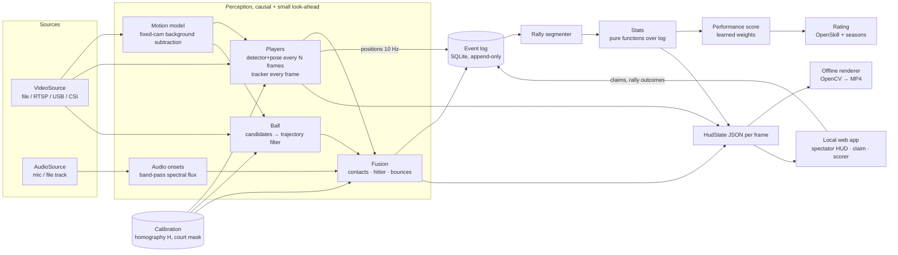

# pickleballOS — Design

**Status:** draft v0.1 · 2026-10-29 · for review before Phase 3 (player tracking) starts.

A low-cost, privacy-first, fixed-camera system that watches a recreational pickleball doubles match, turns
video + audio into an event log, and from that log produces (1) a live spectator HUD, (2) per-match
performance scores with learned, published weights, and (3) a seasonal team-aware rank.

Visual reference for the HUD: the "RALLY / INSIGHTS" badminton overlay (speed card, rally-total card,
distance-covered card, mini court map, floor rings with P1–P4 tags, every estimate marked `~` / `EST.`).

---

## 1. Real-time: what is live and what comes after

The spectator goal is real time, and that is realistic for the parts spectators actually watch. The
stats that feed the score and rank are *inherently* post-rally — "was the third-shot drop successful?"
depends on shots that haven't happened yet — so they never needed to be real time.

| Tier | Target delay | Content | Why this delay |
|---|---|---|---|
| **Live HUD** | 0.3–0.6 s behind the camera | P1–P4 rings + tags, court map, distance covered, rally contact count, avg horizontal ball speed (est.), kitchen occupancy | A short look-ahead buffer (6–10 frames) lets ball smoothing and audio↔vision contact fusion see a few frames into the "future". The video shown to spectators is delayed by the same amount, so overlays stay glued to the frame. |
| **Post-rally** | 1–3 s after the rally ends | Bounce list, shot list + shot types, serve/return depth, third-shot drop result, dink length + who broke it, speed-up result, possible kitchen faults (est.) | Needs the whole rally. |
| **Post-game** | seconds | Performance score, rating update, badges | Needs rally outcomes and the full game. |

**One pipeline, two modes.** All perception code is *causal with a bounded look-ahead*. "Offline" is the
same pipeline fed by a file source and run unpaced (as fast as the machine allows); "live" is the same
pipeline fed by a camera/RTSP source and paced to wall-clock time. Phase 1 offline work is therefore not
throwaway — it *is* the live system.

**Expected feasibility (to be measured in Phase 10, not promised):**
- RTX 3060 laptop (dev machine): all tiers live at 720p30 / 1080p30 with headroom. Small pose model at
  10–15 Hz + tracker in between + ball model on a court crop at full rate is a light load for this GPU.
- ~$300 edge box: the Live tier is the risk, specifically ball tracking at full frame rate. Degradation
  order when behind: (1) pose runs less often (tracker predicts), (2) ball model on motion ROIs only,
  (3) ball at half rate, (4) HUD drops speed card. Audio onset detection is never skipped (it is ~free).

---

## 2. Architecture



### Module boundaries

| Package | Responsibility | Depends on |
|---|---|---|
| `pbos.court` | Court dimensions, named keypoints, line segments, zones (kitchen etc.) | — |
| `pbos.calibration` | Homography fit, residuals, save/load, image↔court projection, court mask, verification overlay | court |
| `pbos.io` | `VideoSource` / `AudioSource` with presentation timestamps (pts); pacing for live mode | — |
| `pbos.perception` | motion model, player detector/pose/tracker, ball tracker, audio onsets, fusion | calibration, infer |
| `pbos.infer` | `InferenceBackend` interface + ONNX Runtime / OpenVINO / Hailo implementations | — |
| `pbos.events` | Event dataclasses, SQLite event log writer/reader | — |
| `pbos.stats` | Rally segmentation + derived stats (pure functions, unit-tested on synthetic logs) | events, court |
| `pbos.hud` | `HudState` schema, OpenCV renderer, web HUD assets | court, calibration |
| `pbos.score` | Feature extraction, training, feature-importance report, inference | stats |
| `pbos.rating` | OpenSkill wrapper, performance multiplier, seasons, badges | score |
| `pbos.web` | FastAPI app: spectator page, claim flow, scorer, admin calibration | everything above |

### The swappable inference layer

Everything ML goes through one interface, with ONNX as the single interchange format:

```python
class InferenceBackend(Protocol):
    def load(self, model_path: str, input_shapes: dict[str, tuple[int, ...]]) -> None: ...
    def infer(self, inputs: dict[str, np.ndarray]) -> dict[str, np.ndarray]: ...
```

Implementations: `OnnxRuntimeBackend` (CPU / CUDA / DirectML — dev laptop), `OpenVinoBackend` (Intel
iGPU/NPU), `HailoBackend` (HEF files compiled from the same ONNX). Pre/post-processing stays in Python,
outside the backend, so a model behaves identically across hardware.

### Look-ahead buffer

The live worker keeps a ring buffer of the last *K* frames (default K=8 ≈ 267 ms at 30 fps). Perception
results for frame *t* are finalized when frame *t+K* arrives. The spectator video is delayed by K frames
too, so `HudState(t)` is always drawn on frame *t*.

---

## 3. Court coordinate system

Units are **feet**. Origin is the **near-left baseline corner** as seen from the camera.

```
 y=44  +---------+---------+   far baseline
       |         |         |
 y=29  +---------+---------+   far kitchen (NVZ) line
       |     far kitchen   |
 y=22  ===================== net (36 in at sidelines, 34 in at center)
       |    near kitchen   |
 y=15  +---------+---------+   near kitchen (NVZ) line
       |         |         |
 y=0   +---------+---------+   near baseline (camera side)
      x=0      x=10      x=20
```

Twelve painted intersections are named keypoints (corners, kitchen-line ends, centerline ends).
Calibration needs **any ≥4 visible ones, not necessarily the 4 corners** — the net-line GoPro sample
has both baselines out of frame but 6 kitchen-line points visible. Lines are 2 in wide; v1 clicks line
centers and ignores the ±1 in offset (documented error source).

Player position = midpoint of the two ankle keypoints (fallback: bottom-center of the box), projected
through H. That is exact only for a point on the ground; a foot in the air adds error, which is why
positions are smoothed and labeled "court estimate".

---

## 4. Event log schema

SQLite in WAL mode. Perception output is **append-only**: corrections are new rows that reference the
row they supersede. Every derived numeric value carries an `estimated` flag.

```sql
CREATE TABLE calibrations (
  id INTEGER PRIMARY KEY, court_id TEXT NOT NULL, created_at TEXT NOT NULL,
  image_w INTEGER, image_h INTEGER,
  H TEXT NOT NULL,              -- JSON 3x3, image px -> court ft
  keypoints TEXT NOT NULL,      -- JSON {name: [u, v]}
  rms_err_ft REAL, max_err_ft REAL
);

CREATE TABLE sessions (
  id TEXT PRIMARY KEY,          -- random UUID
  court_id TEXT NOT NULL, calibration_id INTEGER REFERENCES calibrations(id),
  started_at TEXT NOT NULL, ended_at TEXT,
  fps REAL, mode TEXT CHECK (mode IN ('offline','live')),
  config TEXT                   -- JSON: model versions, thresholds
);

-- Anonymous identity. token_hash = SHA-256(token); the raw token only lives on the phone.
CREATE TABLE identities (token_hash TEXT PRIMARY KEY, created_at TEXT NOT NULL);
CREATE TABLE claims (
  session_id TEXT REFERENCES sessions(id), slot TEXT CHECK (slot IN ('P1','P2','P3','P4')),
  token_hash TEXT REFERENCES identities(token_hash), claimed_at TEXT NOT NULL,
  PRIMARY KEY (session_id, slot)
);

CREATE TABLE games (
  id INTEGER PRIMARY KEY, session_id TEXT REFERENCES sessions(id), game_no INTEGER,
  team_a TEXT, team_b TEXT,     -- JSON ["P1","P2"]
  score_a INTEGER, score_b INTEGER, winner TEXT CHECK (winner IN ('A','B')),
  rated INTEGER DEFAULT 0
);

CREATE TABLE rallies (
  id INTEGER PRIMARY KEY, game_id INTEGER REFERENCES games(id), rally_no INTEGER,
  start_ts REAL, end_ts REAL, server_slot TEXT,
  winner_team TEXT CHECK (winner_team IN ('A','B')),
  outcome_source TEXT CHECK (outcome_source IN ('scorer','auto')),
  end_reason TEXT               -- winner | out | net | fault | unknown
);

CREATE TABLE events (
  id INTEGER PRIMARY KEY, session_id TEXT NOT NULL, rally_id INTEGER,
  ts REAL NOT NULL, frame INTEGER,
  type TEXT NOT NULL,           -- contact | bounce | serve | net_touch | kitchen_entry | possible_fault
  slot TEXT,                    -- hitter / actor if known
  court_x REAL, court_y REAL,   -- feet
  img_u REAL, img_v REAL,       -- pixels
  conf REAL, estimated INTEGER NOT NULL DEFAULT 1,
  source TEXT,                  -- audio | vision | fused | manual
  supersedes INTEGER REFERENCES events(id),
  extra TEXT                    -- JSON
);

CREATE TABLE positions (        -- ~10 Hz samples, the only continuous signal stored
  session_id TEXT NOT NULL, ts REAL NOT NULL, slot TEXT NOT NULL,
  court_x REAL, court_y REAL, conf REAL, estimated INTEGER NOT NULL DEFAULT 1,
  PRIMARY KEY (session_id, ts, slot)
);

CREATE TABLE shots (            -- derived, rebuildable from events
  id INTEGER PRIMARY KEY, rally_id INTEGER REFERENCES rallies(id), shot_no INTEGER,
  hitter_slot TEXT, contact_event INTEGER, bounce_event INTEGER,
  shot_type TEXT,               -- serve | return | third_drop | third_drive | dink | speedup | volley | lob | other
  speed_mph_est REAL, depth_ft REAL, result TEXT
);

CREATE TABLE rally_features (   -- training rows for the performance score
  rally_id INTEGER, slot TEXT, name TEXT, value REAL, PRIMARY KEY (rally_id, slot, name)
);
CREATE TABLE perf_scores (game_id INTEGER, slot TEXT, score REAL, model_version TEXT,
  PRIMARY KEY (game_id, slot));

CREATE TABLE seasons (id INTEGER PRIMARY KEY, name TEXT, starts TEXT, ends TEXT, params TEXT);
CREATE TABLE ratings (token_hash TEXT, season_id INTEGER, mu REAL, sigma REAL,
  matches INTEGER, placement_left INTEGER, updated_at TEXT, PRIMARY KEY (token_hash, season_id));
CREATE TABLE rating_history (token_hash TEXT, game_id INTEGER, mu_before REAL, sigma_before REAL,
  mu_after REAL, sigma_after REAL, perf_multiplier REAL);
CREATE TABLE badges (token_hash TEXT, season_id INTEGER, code TEXT, awarded_at TEXT,
  PRIMARY KEY (token_hash, season_id, code));
```

Unclaimed slots appear in `positions`/`events`/`shots` under a session-local slot only; nothing links
them to an identity or to any other session.

---

## 5. Decisions and alternatives

| Decision | Chosen | Alternatives considered | Why |
|---|---|---|---|
| Player detector + pose | **rtmlib** (RTMDet/YOLOX detector + RTMPose, ONNX, Apache-2.0) | Ultralytics YOLO11n-pose (**AGPL-3.0**); MediaPipe Pose (single-person); MMPose full stack (heavy deps) | Permissive license, ONNX-native so it runs on ORT/OpenVINO, small models available. YOLO11-pose is excellent and could be an optional backend if you accept AGPL (see §14). |
| Multi-object tracking | Minimal **ByteTrack-style** tracker (Kalman + two-stage IoU association) re-implemented, plus court-space gating (≤4 on-court tracks, max speed) | DeepSORT (needs re-ID net), OC-SORT, BoT-SORT | Four players in a known area is an easy case; court-space constraints matter more than appearance. In-session appearance (color histogram) only to recover from occlusion swaps. |
| Ball | **Classical baseline first** (background diff + color + blob shape + trajectory filter), then a **TrackNet-family heatmap model** (TrackNetV2/V3, WASB-style) fine-tuned on our footage | Generic object detector for the ball (poor on 3–10 px blurred blobs) | The classical tracker is needed anyway as a fallback and as the auto-labeler for the learned model. |
| Contacts | **Fused**: audio onset ∧ (ball direction change ∨ wrist–ball proximity) within ±2 frames | Audio only (adjacent courts pop too); vision only (misses occluded contacts) | Adjacent-court pops are rejected by requiring vision support; occluded contacts are kept when audio + wrist agree. |
| Bounces | Ball image-velocity reversal away from players, no paddle-pop onset; point mapped through H | Learned bounce classifier | The ground point maps exactly through H, so 2D is enough for bounce position. |
| Rally outcome | **Scorer UI** on a phone (tap "point" / "side out" — the score sequence implies the rally winner) | Automatic inference from last bounce / net | Ground truth for training must be correct; auto-inference becomes a later accuracy experiment. |
| Calibration | **≥4 named keypoints**, least-squares homography, per-point residual report | 4 corners only; learned court-line detector | Works when baselines are off-frame; zero training data; residuals catch bad clicks. |
| Storage | SQLite (WAL) append-only | Postgres; Parquet files | Zero-admin, single file, fine at this write rate (~50 rows/s). |
| Rating | **OpenSkill** (Plackett-Luce, `openskill` Python package, MIT) | TrueSkill (Microsoft patent/trademark), Glicko-2 (not team-native), Elo | Team-aware, Bayesian (μ, σ), open. |
| Performance score | **Logistic regression**, VAEP-style action valuation (§6) | Gradient boosting + SHAP; hand-tuned weights | Coefficients are the explanation; easy to publish. GBM is a robustness check, not the shipped model. |
| Live delivery | MVP: frames (JPEG) + HudState over one **WebSocket** from the worker. Upgrade: MediaMTX WebRTC video + timestamped telemetry, synced with `requestVideoFrameCallback` | Burn overlays into an encoded stream (HLS) | MVP is trivially frame-synced and fine for a handful of LAN viewers; the upgrade scales to many viewers. |
| Rendering | Overlays drawn from `HudState` by **two renderers** (OpenCV for offline MP4, canvas in browser) | Server-side burn-in only | Crisp vector HUD on any screen size; one data contract. |

---

## 6. Performance score (ACS-style, learned)

**Unit of credit: the shot.** Following VAEP (Decroos et al., KDD 2019 — action valuation in soccer),
each shot is credited by how much it changed its team's chance of winning the rally:

1. Describe the rally state *before* and *after* each shot with a small, interpretable vector:
   ball landing zone/depth, incoming shot type, positions of all four players (both at kitchen? partner
   gap?), shot number, serving side.
2. Fit a logistic regression `P(team wins rally | state)` on all logged states (label = rally outcome).
3. Shot value `Δ = P(after) − P(before)` for the hitter's team, credited to the hitter.
4. Per-player per-game score = mean Δ per rally played, normalized so the game average is 100
   (like ACS), plus a small positional component (kitchen arrival time, coverage) also expressed in Δ.

This credits the drop that forced a pop-up, not only the put-away. The finishing shot gets the final
jump from "likely" to "won", which is exactly what it deserves.

**Fallback / first version** (the one the brief asks for): per-rally per-player features → logistic
regression on rally outcome using *team-difference* features; the learned coefficient vector is the
score's weights. Doubles credit assignment in this version: features are measured per player, and
outcome-only credit is split by an exponentially-decayed share of the last *k* shots (γ=0.6), so the
setup shot gets ~0.6× the finisher's credit. VAEP replaces this once shot states are reliable.

**Explainability deliverable:** coefficient table with bootstrap 95% CIs, permutation importance,
per-game "why your score is 132" breakdown (top 3 positive / negative contributions).

**Leakage rules:** train/test split by **session date** (never random rallies); features may only use
information up to the shot being valued.

---

## 7. Rank system

- **Engine:** OpenSkill Plackett-Luce, teams of two, one update per game.
- **Wins drive rank.** The performance score only scales the *size* of each player's update:
  `Δμ_i' = Δμ_i · clamp(1 + k·z_i, 0.8, 1.2)`, where `z_i` is the player's standardized score within
  that game and `k ≈ 0.1`. The sign never flips: a winner never loses μ, a loser never gains. σ updates
  are left untouched.
- **Anti-farming:** ±20% cap; only games with ≥ N rallies, four claimed or anonymous-but-tracked players
  and a scorer-confirmed result are rated; the score's features are by construction the ones that
  predict winning, so "farming" them means playing better.
- **Displayed rank:** conservative `μ − 3σ`, bucketed into named tiers.
- **Season reset:** `μ' = μ₀ + α(μ − μ₀)` (α≈0.5), `σ' = min(σ + δ, σ₀)`; first 5 games are
  placement (rank hidden, larger σ).
- **Rewards:** participation and milestone badges (games played, first 10-dink rally, kitchen-arrival
  streak…), cosmetic HUD tag colors. No tokens, no currency.
- **Simulation (Phase 8):** synthetic players with true skill + noisy "performance", verify convergence,
  multiplier bounds, and reset behaviour before any real data exists.

---

## 8. Identity and privacy

**Hard rules:** no face recognition; no cross-session biometrics; no raw video stored by default; people
outside the court mask are never tracked; estimated values are labeled.

**Claim flow (no signup):**
1. A QR code / NFC tag at the court opens `http://<device>.local/claim?court=1` on the local Wi-Fi.
2. The page shows a court diagram; the player taps their **starting position** (near-left, near-right,
   far-left, far-right) for the current game, which maps to slot P1–P4.
3. First visit: the device generates a random 128-bit token, stores it in the phone's browser storage,
   and keeps only `SHA-256(token)`. Later visits from the same phone reuse it → seasonal history.
4. Optional recovery code (shown once) to move the token to a new phone. No name, email or phone number.
5. Tracks are bound to slots by starting position at the first serve and then follow tracker continuity;
   in-session appearance features are discarded at session end.

**Live stream caveat:** the spectator video itself is personal data (identifiable people). Default: LAN
only, not recorded, court signage + a privacy notice, players can request "stats-only" mode (HUD
without video). Highlights are saved only on explicit request by a claimed player and auto-expire.

**RA 10173 (Data Privacy Act of 2012) checklist:** consent and privacy notice before collection; data
minimization (stats, not video); stated retention period; access/deletion request path keyed by token;
security of the device (disk encryption, LAN-only admin). Check whether NPC registration applies to
the venue/university. **University ethics board approval is required before recording any real
players**; until then development uses public sample footage locally (not redistributed) and synthetic
data.

---

## 9. Hardware path

| Phase | Hardware | Goal |
|---|---|---|
| 1 | Dev laptop (RTX 3060 Laptop, 6 GB) + recorded video | Correctness |
| 2 | Same laptop + camera/RTSP (simulated with `ffmpeg -re` from a file) | Live tier at 30 fps, measured latency |
| 3 | Edge box, Option A or B | FPS, latency, power, cost per court |

**Option A — Raspberry Pi 5 (8 GB) + AI HAT+ 26 TOPS (Hailo-8).** Cheapest and lowest power. Caveats:
models must be compiled to HEF with Hailo's Dataflow Compiler (closed, x86 Linux, needs a calibration
set; unsupported layers must be rewritten); **the Pi 5 has no hardware H.264 decoder**, so an H.264 IP
camera costs CPU — prefer a CSI camera (no decode) or an HEVC stream; tracking, audio, fusion and the
web server all share 4 Cortex-A76 cores.

**Option B — Intel mini-PC with OpenVINO.** An N-series (N100/N150 class) box uses its iGPU via
OpenVINO and Quick Sync decode at roughly Pi-kit cost; a Core Ultra box adds an NPU at higher cost and
power. Open toolchain, accepts our ONNX models as-is, x86 so the dev code runs unchanged.

**Recommendation:** build and measure on **Option B (N-series + iGPU)** first — it removes toolchain
risk from a single-student timeline and stays near the $300 line. Port to Option A only if RQ (c)
becomes primary or power is a hard constraint; the `InferenceBackend` interface keeps that a contained
job. Prices vary locally and should be checked at purchase time.

**Camera:** 1080p at 60 fps with manual exposure (short shutter, ~1/1000 s) matters more than any
model upgrade for ball tracking. Mount elevated (≥ 3–4 m ideally) behind a baseline corner so all four
corners are visible. A second synced camera later enables triangulation (net clearance, contact
height); the event schema already allows `extra` 3D fields.

---

## 10. Risks and fallbacks

| Risk | Impact | Mitigation / fallback |
|---|---|---|
| Ball motion blur at 30 fps auto-exposure | Missed / smeared detections | Short shutter + 60 fps camera; heatmap model trained on blurred balls; physics fill between detections |
| Ball occlusion by players / net | Gaps in trajectory | Trajectory filter predicts through gaps; contact/bounce from audio + positions; report coverage % honestly |
| Adjacent courts (balls, pops, players) | False contacts, false tracks | Court-mask gating for players/ball; audio onsets require vision support |
| Static yellow logos / overlays | False ball candidates | Background model + static ignore mask set at calibration |
| Overlapping players (partners) | ID swaps | Court-space gating, team-side constraint, in-session color histogram |
| Outdoor sun, shadows, PH weather | Detection drop | Fixed-camera background model adapts slowly; evaluate indoor vs covered vs outdoor separately |
| Wide-angle lens distortion | Homography error at frame edges | Residual report flags it; v2: fit radial distortion jointly with H |
| "Fixed" camera gets bumped / re-aimed | Every position silently wrong | **Observed in the sample**: `dsrgtsdg.mp4` is steady (≤ 2.3 px) until ~460 s, then shifts ~160 px. Phase 3 adds a camera-move check: ORB features on the static background vs the calibration frame every few seconds; small shift → re-base H through the frame-to-frame homography; large shift → pause stats and ask for re-calibration |
| Far-court resolution (few px per ft) | In/out calls near far lines uncertain | Report bounce error by court zone; no line calling claims |
| Too few matches for RQ (a) | Underpowered comparison | Simulation-based power estimate first; chronological CV; report CIs; negative result is still a result |
| Edge box too slow | Live tier degrades | Degradation ladder (§1); post-rally stats unaffected |
| Ethics approval delay | No real data | Synthetic + public footage for engineering; data collection scheduled after approval |

---

## 11. Evaluation plan

| What | Ground truth | Metric |
|---|---|---|
| Calibration | Cones at known court coordinates in one frame | Reprojection error (ft), by zone |
| Player positions | Feet clicked at 1 Hz on 3 × 3-min clips | Court-space error (ft), ID-switch count, MOTA |
| Ball | Ball center clicked on ~1,500 frames (10 rallies, auto-prelabeled) | Detection precision/recall at ≤ 5 px, trajectory coverage % |
| Contacts / bounces | Event timestamps marked on ~20 rallies | Event F1 at ±2 frames; hitter accuracy; bounce position error (ft) |
| Stats | Manual stat sheet for 5 games (third-shot type/result, dinks, errors) | Per-stat accuracy / MAE |
| Rating (RQ a) | Game results, chronological split | Log loss + Brier vs OpenSkill win/loss-only baseline; bootstrap CIs; calibration plot |
| System | — | FPS, glass-to-glass latency, watts, cost per court, per hardware option |

Estimated labeling effort for one student: **~15–20 hours total** (ball ~6 h with prelabels, events
~3 h, positions ~3 h, stat sheets ~5 h). Tools: a small click-labeler in this repo, or CVAT.

---

## 12. Licenses of dependencies

| Component | License | Use |
|---|---|---|
| OpenCV (`opencv-python`) | Apache-2.0 (wheels MIT) | Video I/O, geometry, drawing |
| NumPy / SciPy | BSD-3 | Numerics |
| ONNX Runtime | MIT | Inference backend |
| OpenVINO | Apache-2.0 | Inference backend |
| rtmlib / RTMPose / RTMDet | Apache-2.0 | Player detection + pose |
| ByteTrack (reference algorithm) | MIT | Re-implemented tracker |
| librosa (or scipy.signal only) | ISC | Audio onsets |
| scikit-learn | BSD-3 | Score model |
| openskill (Python) | MIT | Rating |
| FastAPI / Uvicorn | MIT / BSD-3 | Local web app |
| MediaMTX | MIT | Optional WebRTC fan-out |
| pytest | MIT | Tests |
| TrackNetV3 / WASB code + weights | **verify before use** | Ball model (may retrain from scratch instead) |
| Ultralytics YOLO11 | **AGPL-3.0** | Not used by default (see §14) |
| HailoRT / Dataflow Compiler | HailoRT open (MIT/LGPL parts); DFC proprietary | Option A only |

---

## 13. Answers to "questions to think through"

### Q1. Which research question should be primary?

**Recommendation: (a) — does a stat-informed rating predict outcomes better than a win/loss-only
rating — as primary, with (c) as a secondary, supporting contribution.**

- (a) is what makes the system more than "a cheaper PB Vision": it is falsifiable with data the system
  itself produces, and it forces the rest (stats accuracy, credit assignment) to be good enough.
- (c) comes almost for free — you must report stat accuracy and FPS/latency anyway to trust (a). But
  "match cloud tools" needs access to the cloud tools' outputs on the same games, which you may not get;
  framed as "accuracy vs human labels, at what cost/latency", it stands on its own.
- (b) needs a multi-week user study with enough distinct players to see behaviour change, plus a
  control group — the hardest to run well alone and the most sensitive ethically. Good future work.

Risk for (a): it needs many games among a recurring player pool (estimate: 100–300 games, 30–60
players over a semester at one venue). The Phase 8 simulation will estimate how many are needed for a
detectable effect *before* data collection.

### Q2. Is one camera enough?

**Yes, for (a) and the minimum stat set.** Everything in it is a ground-plane quantity (positions,
bounces) or a timing quantity (contacts, rally structure), and the homography is exact on the ground.
What one camera cannot do: net clearance, contact height, true 3D ball speed. These are shown only as
"est." or omitted. A second camera is only required if (c) is primary *and* you want to compare 3D stats.

### Q3. Ground truth — how much labeling is realistic?

See §11: ~15–20 hours. The trick is to label **events, not frames** wherever possible (a contact is one
timestamp, not a box per frame), and to **prelabel** with the classical tracker so humans only fix
mistakes. Rally outcomes come from the scorer UI during play, so they need no post-hoc labeling.

### Q4. Minimum viable stat set (for RQ a)

Kept: distance covered, kitchen occupancy %, time to reach the kitchen after the return, partner
spacing, third shot type (drop/drive) + result, dink count + who broke it, speed-up attempts + result,
errors attributed to last hitter (forced/unforced = est.), serve/return depth.
Displayed but not used as score features until validated: shot speed (est.), possible kitchen faults.
Dropped for single-camera v1: net clearance, contact height.

### Q5. Biggest risks

Ball tracking (blur + occlusion) is the #1 risk; contact attribution in fast kitchen exchanges is #2;
data volume for RQ (a) is #3. Fallbacks in §10. The design keeps the *score and rank* dependent on
robust primitives (positions, contacts, bounces) rather than on fragile ones (3D, speeds).

---

## 14. Open decisions (yours)

1. **Primary RQ:** (a) recommended — confirm or pick (c).
2. **AGPL:** OK to offer Ultralytics YOLO11-pose as an optional backend (repo must then be AGPL-compatible
   if distributed with it), or stay strictly permissive (rtmlib only)?
3. **Repository license:** MIT / Apache-2.0 / other (not added yet).
4. **Edge budget:** is "~$300 per court including camera" the hard number?
5. **Venue:** indoor, covered, or outdoor court for data collection? Changes lighting priorities.

---

## 15. Phase plan

| # | Deliverable | Status |
|---|---|---|
| 1 | DESIGN.md | this document |
| 2 | Calibration tool (`pbos calibrate`) + top-down verification overlay | implemented |
| 3 | Offline player tracking → court positions → distance + court-map overlay video | **paused for review** |
| 4 | Ball tracking, bounces, audio contacts, fusion | |
| 5 | Event log + stats with synthetic-event unit tests | |
| 6 | HUD renderer (offline MP4 + web) in the reference style | |
| 7 | Performance score training + importance report | |
| 8 | OpenSkill rating, seasons, simulation | |
| 9 | QR/NFC claim + scorer web flow | |
| 10 | Real-time mode + edge measurements | |
| 11 | Evaluation scripts | |

---

## Appendix A — notes on the earlier research doc (`pickleball_tracker_research.md`)

Kept: fixed-camera calibration instead of a court model, ankle-midpoint → H for positions, horizontal
speed only between contact/bounce endpoints, client-side HUD rendering, short look-ahead buffer,
`ffmpeg -re` to simulate a live camera, and the sample-video triage (`dsrgtsdg.mp4` as primary).

Corrected / flagged:
- **Ultralytics `yolo11n-pose` is AGPL-3.0**, which conflicts with the permissive-license rule — moved
  to optional (§5, §14).
- **"TrackNetV4-Lite"** is not a release I can confirm; treated here as "a TrackNet-family model, sized
  down", to be verified when Phase 4 starts.
- Detection rates (75–85 %, 98 %+) and per-frame timings in that doc are estimates, not measurements.
  They are measured in Phases 4 and 10.
- `dsrgtsdg.mp4` has no jump cuts but is **not fixed for the whole video**: the camera is re-aimed at
  ~460 s (measured, see §10). The sample calibration in `calib/samples/` is valid for ~20–460 s.
- Sample videos verified: all 1280×720, ~30 fps, AAC 44.1 kHz. `dsrgtsdg.mp4` is outdoor tournament
  footage with a burned-in scoreboard and logos → static ignore mask needed. The net-line GoPro clip
  has visible wide-angle distortion. These are third-party videos: fine for local development, **not
  committed to the repo** and not used for published evaluation without permission.
